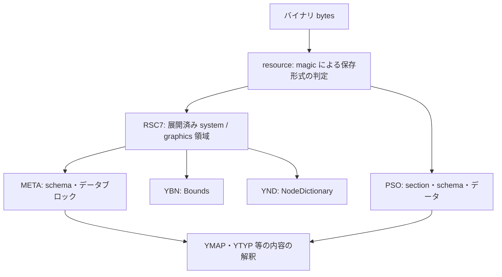

> This document was generated with AI assistance (GitHub Copilot).

# Resource の保存形式と解釈の関係

## 概要

GTA V の resource を読むときは、**保存形式**と**内容の種類**を分けます。
RSC7 は圧縮された領域を包む形式、META はその領域内にある schema とデータの表現です。
PSO は META と異なる section・schema・参照表を持つ独立した保存形式です。

したがって、RSC7 を展開した結果が必ず META になるわけではありません。
YBN の Bounds や YND の NodeDictionary も RSC7 内に格納されます。

この資料は本リポジトリの GTA V Legacy 対応を説明します。
ゲーム本体の全形式を網羅する仕様ではありません。YMAP の内容は [YMAP 資料](ymap.md)を参照してください。

## 責務

| モジュール | 担当 | 担当しないこと |
| --- | --- | --- |
| `resource` | バイナリの magic 判定と RSC7 / PSO の読込入口 | 拡張子からの内容解釈、XML 入力、ファイル探索 |
| `rsc7` | ヘッダ検証、DEFLATE、page flags、system / graphics 領域、仮想アドレス | META schema、YMAP の配置、Bounds の形状 |
| `meta` | RSC7 の領域から META を読むこと、schema とデータブロックの構築 | 圧縮処理、ファイル種別ごとの業務処理 |
| `meta::xml` | 汎用 META の値表現と CodeWalker XML の相互変換 | YMAP モデルへの変換 |
| `pso` | section・mapping・schema の解釈、XML 表現、template 更新 | RSC7 の展開、META の参照解決 |
| `format/ymap` 等 | 配置・光源・衝突等の型付きモデルへの変換と検証 | ファイル探索やバッチ処理 |
| `stream_file` | 拡張子による種別（`FileType`）判定、1ファイル単位の型付きモデル・XML・binary 変換 | 保存形式固有の低レベル処理、バッチ処理 |
| `core::conversion` | ファイル・ディレクトリ単位のバッチ変換、schema の収集 | 1ファイルの変換処理 |

`resource` は入力 bytes の `RSC7` / `PSIN` を確認します。
一方、拡張子は `stream_file` の `FileType` が YMAP・YTYP・YMT・YBN・YND の adapter を選ぶために使います。
拡張子だけでは保存形式を判定できません。
RSC7 専用と分かっている YBN / YND の reader は、共通の形式判定を省いて RSC7 codec を直接利用します。

## 読み取りと書き出し

### RSC7 と META

読み取りでは、まず RSC7 を展開し、その結果を META reader に渡します。
META reader は system 領域内のヘッダ、schema、データブロックと参照を解釈します。
YMAP の reader はさらに META の値を配置モデルへ変換します。

書き出しは逆方向です。モデルや XML から META を構築し、META writer が RSC7 の領域を生成します。
最後に RSC7 writer がヘッダと圧縮 payload を生成します。

この流れの「META を生成する」は、読込時には既存の META データを解析する意味です。
RSC7 から別の形式へ自動変換したり、すべての RSC7 に META を付けたりする処理ではありません。

### PSO

PSO は RSC7 や META を経由せず、PSO reader が直接読みます。
YMAP reader は PSO に埋め込まれた schema でフィールドを読み、XML を経由せず共通の配置モデルへ変換します。
RSC7/META と同じ配置を扱えても、byte order、参照、layout は共有しません。

PSO の書出しは現実装では既存 template の更新です。META からの新規 PSO 生成ではありません。
配列長や確保済み文字列容量の変更、`CHKS` を持つ PSO の変更には制約があります。

### XML と未対応形式

XML は編集・表示用の表現であり、RSC7 / PSO のバイナリ判定入口には渡しません。
既存の YMT テキスト XML 対応は変換 adapter に残します。
RBF 等の未対応バイナリは、別形式として明示的に拒否します。

## 依存関係の原則

- `rsc7` は `meta` や YMAP のモデルに依存しません。
- `meta` は展開済み RSC7 を読み、RSC7 へ戻せます。
- `pso` は RSC7 / META とは独立した codec です。
- YMAP の配置モデル変換と厳密な光源配列検証は YMAP 側が所有します。
- 汎用 META の値表現では、既存の CodeWalker XML に対応する命名・属性・配列規則を維持します。
- ファイル探索・名前の事前収集・出力先の管理は codec の外側に置きます。

## 実装の配置

| 処理 | 実装 |
| --- | --- |
| 保存形式の判定 | [Resource](../../src/core/format/gamefile/resource.rs) |
| 展開済み RSC7 のモデルと仮想アドレス | [rsc7/model.rs](../../src/core/format/gamefile/rsc7/model.rs) |
| RSC7 の読込・書出し | [rsc7/read.rs](../../src/core/format/gamefile/rsc7/read.rs)、[rsc7/write.rs](../../src/core/format/gamefile/rsc7/write.rs) |
| META のモデル | [meta/model.rs](../../src/core/format/gamefile/meta/model.rs) |
| RSC7 領域と META の相互変換 | [meta/read.rs](../../src/core/format/gamefile/meta/read.rs)、[meta/write.rs](../../src/core/format/gamefile/meta/write.rs) |
| META と XML の相互変換 | [meta/xml/read.rs](../../src/core/format/gamefile/meta/xml/read.rs)、[meta/xml/write.rs](../../src/core/format/gamefile/meta/xml/write.rs) |
| schema 経由のフィールド読み取り | [struct_reader.rs](../../src/core/format/gamefile/struct_reader.rs)、[meta/xml/access.rs](../../src/core/format/gamefile/meta/xml/access.rs)、[pso/access.rs](../../src/core/format/gamefile/pso/access.rs) |
| YMAP モデルへの変換 | [ymap/binary/read.rs](../../src/core/format/ymap/binary/read.rs)、[ymap/binary/decode.rs](../../src/core/format/ymap/binary/decode.rs) |
| PSO codec | [pso/mod.rs](../../src/core/format/gamefile/pso/mod.rs) |
| 種別判定と1ファイルの変換 | [stream_file.rs](../../src/core/format/stream_file.rs) |
| バッチ変換 | [conversion/mod.rs](../../src/core/conversion/mod.rs) |