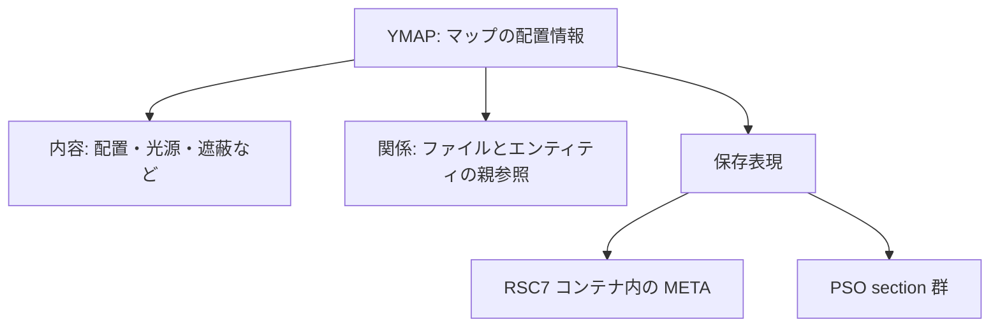
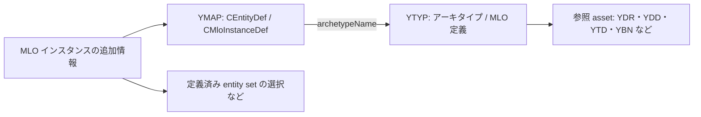
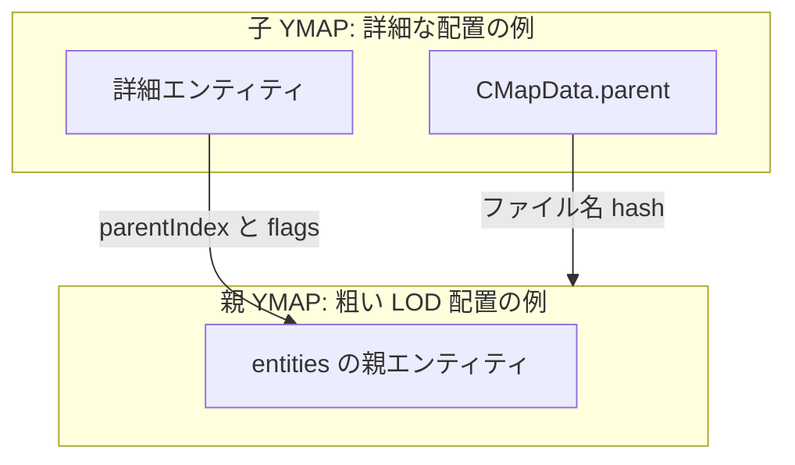
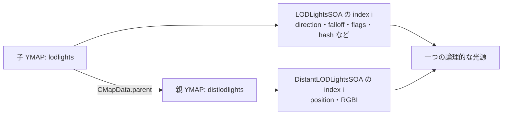
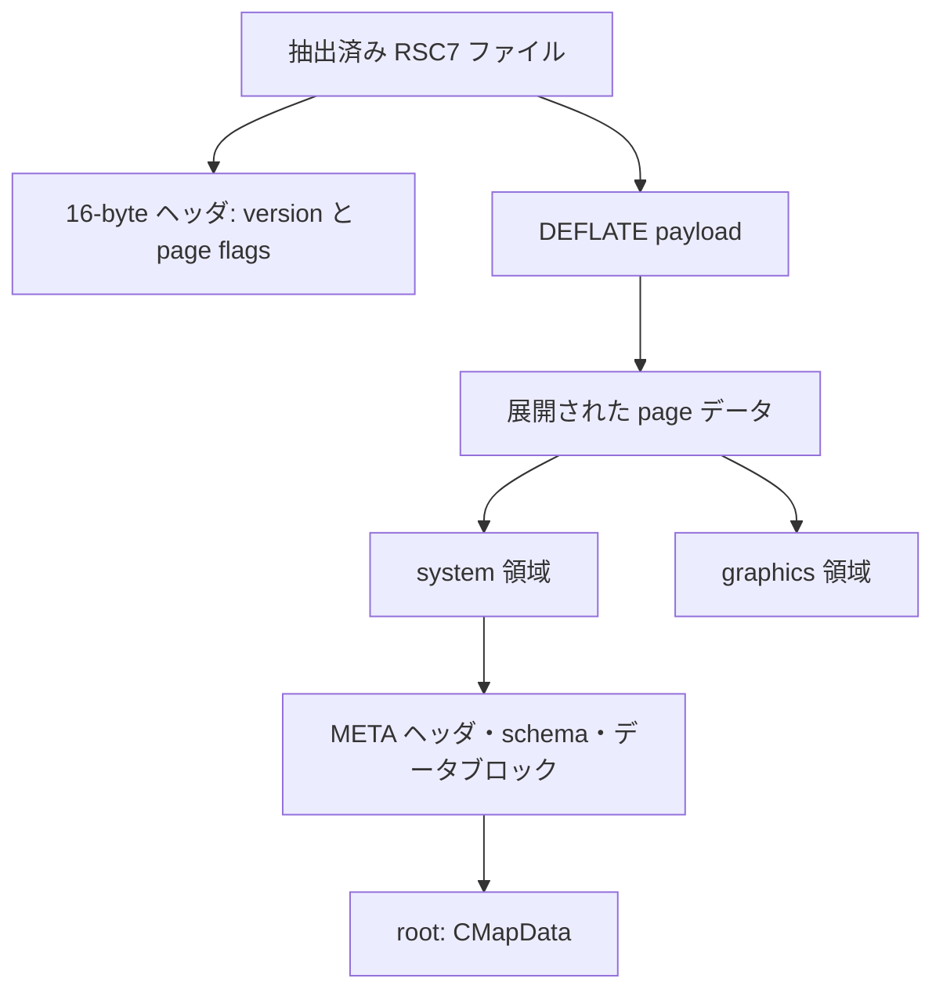
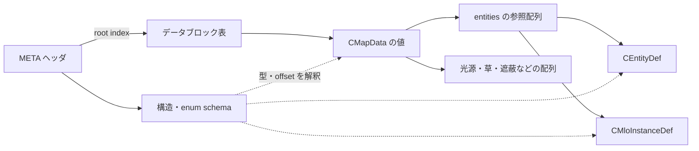
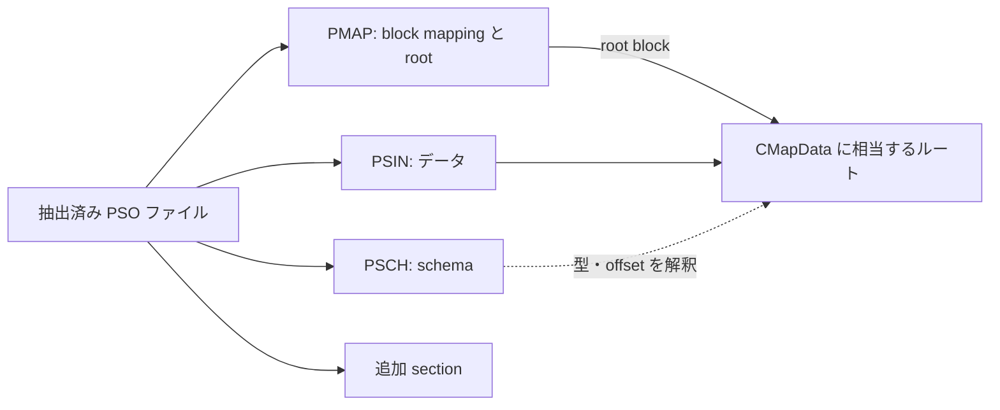

# YMAP の構造とファイル間の関係

> This document was generated with AI assistance.

## 概要

YMAP は GTA V のマップ配置と、その周辺のストリーミング情報を格納するファイルです。
建物や小物の配置だけでなく、MLO の配置、草、LOD 光源、遮蔽、環境効果、車両生成などを含められます。
モデルそのものを格納するファイルではなく、主に「何を、どこに、どの条件で配置するか」を記述します。

理解するときは、次の三つを分けます。

| 見る軸 | 例 | 意味 |
| --- | --- | --- |
| ファイルの役割 | エンティティ配置、光源、遮蔽 | どのデータを主に持つか |
| 参照関係 | YMAP の親参照、エンティティの親参照 | 何と組み合わせて使うか |
| バイナリ表現 | RSC7/META、PSO | 同じ配置情報をどの形式で保存するか |

`small`、`medium`、`large` や `hei_` などの名前は、バイナリ形式を決める識別子ではありません。
実際の役割や関係は、内部データと参照先を確認して判断します。



### この資料の範囲

このリポジトリが扱う GTA V Legacy の実装と、公開されている CodeWalker ソースを主な根拠とします。
他のゲーム世代・ビルドへ固定 offset や動作条件をそのまま適用しないでください。
CodeWalker の読込・描画処理は有用な根拠ですが、GTA 本体の内部処理の完全な仕様ではありません。

## 用語

| 用語 | この資料での意味 |
| --- | --- |
| エンティティ | 建物・小物などの配置一件。通常は `CEntityDef` |
| アーキタイプ | 配置対象の種類の定義。YMAP は `archetypeName` で参照する |
| MLO | 部屋・ポータルなどを持つ内部空間の定義と、その配置。定義と配置は別のファイルにある |
| HD / LOD / SLOD | エンティティの表示階層。概念的には近景の詳細表現から遠景の粗い表現へ進む |
| 親 YMAP | 子 YMAP の `CMapData.parent` が参照する YMAP |
| 親エンティティ | 配置一件の `parentIndex` が指定する、LOD 階層上の親 |
| AABB | ワールド座標軸に平行な包囲箱。最小・最大座標で表す |
| OBB | 向きを持つ包囲箱。AABB と異なり、任意の方向へ回転できる |
| SOA | Structure of Arrays。各属性を別々の配列に保存し、同じ index を一件のデータとして結び付ける形式 |
| schema | フィールドの型・offset・参照型などを示す構造定義 |
| META | RSC7 内で使われる、schema とデータブロックを持つ表現 |
| PSO | META とは別の、schema・データ・参照表を section 群で持つバイナリ表現 |
| hash | 名前などを表す数値。文字列や GUID、配列 index とは別の識別情報 |

## ファイルの役割と参照関係

### 1. ファイル名は手掛かりであり、型の定義ではない

次の名前は用途を推測する手掛かりになります。ただし、複数のデータ種別を一つの YMAP に入れることもできます。

| 名前の例 | よく見られる用途 | 確認する内部情報 |
| --- | --- | --- |
| 通常の地域名、`*_strm_*.ymap` | 地域・ストリーミング単位のエンティティ配置 | `entities`、`parent`、extents |
| `*_lod.ymap`、`*_slod*.ymap` | LOD 系の配置 | 各エンティティの `lodLevel` と親参照 |
| `*_milo_*.ymap` | MLO インスタンス配置 | `CMloInstanceDef`、参照する YTYP |
| `*occl*.ymap` | 遮蔽用データ | `boxOccluders`、`occludeModels` |
| `*_lodlights*.ymap` | LOD 光源の属性 | `LODLightsSOA` と親 YMAP |
| `*_distlodlights*.ymap`、`*_distantlights.ymap` | 遠景光源の位置・色 | `DistantLODLightsSOA` |
| `hei_*`、`bkr_*`、`lr_*`、接頭辞なし | コンテンツ・更新系統を区別する命名の手掛かり | 収録 archive、DLC、同名ファイルの置換履歴、内部データ |

接頭辞の有無を HD/LOD の分類や優先順位へ直接変換しないでください。
特に、共有リンクにある接頭辞の説明は調査の出発点であり、ここでは確定した意味として採用していません。
同名ファイルの置換関係は親子関係とも異なります。どの版が有効かは archive の mount・DLC・配信構成の問題です。

### 2. YMAP と YTYP の関係

YMAP は配置、YTYP はアーキタイプの定義を担当します。
MLO では、部屋・ポータル・内部エンティティ・entity set などの定義と、それをワールドへ置くインスタンスを区別します。



これは主要な参照の概念図です。すべての asset が必ず YTYP 経由の同じ経路で解決される、という意味ではありません。
衝突形状そのものは通常 YBN 側にあり、YMAP の配置や辞書参照と組み合わせて使われます。

### 3. ファイルの親と、エンティティの親は別

`CMapData.parent` は親 YMAP の名前 hash を表します。
一方、`CEntityDef.parentIndex` はエンティティ配列の index を表します。GUID や名前 hash ではありません。

CodeWalker は `LodInParentYmap`、つまりエンティティの `flags` の bit 3 が設定されているかを見て、
親 YMAP 側の LOD エンティティを参照する配置を区別します。
同一 YMAP 内の階層を構築する場合もあるため、`parentIndex` を常に親ファイルの index と解釈してはいけません。
`-1` は親エンティティを指定しない場合の値です。



表示階層は `lodLevel` で表され、通常の系列には HD、LOD、SLOD1、SLOD2、SLOD3、SLOD4 があります。
ORPHANHD は通常の遠景段階とは別に扱われます。enum の数値をそのまま距離順と考えないでください。
実際の表示切替には `lodDist`、`childLodDist`、親子のロード状態なども関係します。

編集時はエンティティの配列順序を保持し、親削除や並べ替えで `parentIndex` が指す対象を修復する必要があります。
GUID が同じ配置も存在し得るため、GUID だけで配列参照を置き換えることはできません。

根拠: [EnsureEntities / YmapFile.cs](https://github.com/dexyfex/CodeWalker/blob/master/CodeWalker.Core/GameFiles/FileTypes/YmapFile.cs#L260)、
[ConnectToParent / YmapFile.cs](https://github.com/dexyfex/CodeWalker/blob/master/CodeWalker.Core/GameFiles/FileTypes/YmapFile.cs#L944)、
[LodInParentYmap / YmapFile.cs](https://github.com/dexyfex/CodeWalker/blob/master/CodeWalker.Core/GameFiles/FileTypes/YmapFile.cs#L1720)、
[LOD enum / MetaTypes.cs](https://github.com/dexyfex/CodeWalker/blob/master/CodeWalker.Core/GameFiles/MetaTypes/MetaTypes.cs#L2188)。

### 4. LOD 光源と遠景光源は同じ index のペア

LOD 光源は方向・減衰・点灯条件・光源型などを持ちます。
その位置と RGBI は、親 YMAP の遠景光源配列から取得します。
`direction` は光の向きであり、ワールド座標の位置ではありません。



SOA 内では `direction[i]`、`falloff[i]`、`hash[i]` などが一件の LOD 光源を構成します。
それと親側の `position[i]`、`RGBI[i]` を組み合わせます。
light hash はこの親子ペアを検索するキーではありません。

一件を削除するときは両側の同じ index を削除し、残った配列の順序を同期させます。
同じ親を複数の子が参照する場合は、他の子の対応も確認します。
CodeWalker は読込時に最短の配列長へ切り詰めますが、それを「不揃いな配列を安全に編集できる」という根拠にしないでください。

#### small / medium / large

これらは遠景光源の `category` に対応する名称です。

| 名称 | category |
| --- | ---: |
| small | 0 |
| medium | 1 |
| large | 2 |

それぞれが独自の LOD/distant ペアを持ちます。
たとえば `vw_lodlights_medium001` の親が `vw_distlodlights_medium001` という関係であり、
同じ番号の small・medium・large が一つの光源の近・中・遠表現とは限りません。
分類閾値や GTA 本体の category 別切替条件は、ここで参照する CodeWalker 実装だけでは確定できません。
CodeWalker の生成器は category を medium に固定し、描画側の category switch も分類別の分岐処理を実装していません。

根拠: [BuildLodLights / YmapFile.cs](https://github.com/dexyfex/CodeWalker/blob/master/CodeWalker.Core/GameFiles/FileTypes/YmapFile.cs#L2952)、
[YmapLODLight.Init / YmapFile.cs](https://github.com/dexyfex/CodeWalker/blob/master/CodeWalker.Core/GameFiles/FileTypes/YmapFile.cs#L3139)、
[category の生成 / GenerateLODLightsPanel.cs](https://github.com/dexyfex/CodeWalker/blob/master/CodeWalker/Project/Panels/GenerateLODLightsPanel.cs#L240)、
[category の描画 / Renderer.cs](https://github.com/dexyfex/CodeWalker/blob/master/CodeWalker/Rendering/Renderer.cs#L2733)。

### 5. 遮蔽用 YMAP

`occl` というファイル名は遮蔽データの手掛かりですが、内部の `boxOccluders` と `occludeModels` を確認することが先です。
これらは描画の可視性に関係する形状であり、通常の衝突判定用 YBN と同じ役割ではありません。
特定の遮蔽 YMAP がどの配置とロードされるかは、実際の親参照・flags・配信構成を確認します。
名前だけから地域内のすべての YMAP との直接的な親子関係を仮定しないでください。

## YMAP が含み得るデータ

`CMapData` が全体のルートです。以下は主要なフィールド群であり、すべてが一つのファイルに入る必要はありません。
空配列も有効です。また、ファイルのバイナリ形式として存在するデータと、このツールの型や merge が扱えるデータの範囲は別です。

| データ | 型・フィールド例 | 役割 |
| --- | --- | --- |
| 識別・親参照 | `name`、`parent` | YMAP 自身と親ファイルの名前 hash |
| フラグ | `flags`、`contentFlags` | 動作・内容の分類を示す bit field |
| ファイルの範囲 | `streamingExtentsMin/Max`、`entitiesExtentsMin/Max` | ストリーミング範囲と配置データの AABB |
| 通常配置 | `entities` / `CEntityDef` | アーキタイプ、位置、回転、倍率、GUID、LOD 階層など |
| MLO 配置 | `entities` / `CMloInstanceDef` | MLO のインスタンスと、その追加設定 |
| 配置の拡張属性 | エンティティの `extensions` | 個別配置に付随する追加定義 |
| コンテナ LOD | `containerLods` | コンテナ単位の LOD 関連構造。通常のエンティティ配列とは別 |
| ボックス遮蔽 | `boxOccluders` / `BoxOccluder` | ボックス状の遮蔽形状 |
| メッシュ遮蔽 | `occludeModels` / `OccludeModel` | bounds と頂点・三角形等で表す遮蔽形状 |
| 物理辞書参照 | `physicsDictionaries` | 物理関連辞書を指す hash 配列。衝突形状本体ではない |
| インスタンス配置 | `instancedData` | prop と grass のバッチ・インスタンス情報 |
| 環境効果 | `timeCycleModifiers` / `CTimeCycleModifier` | 範囲に対応する timecycle modifier 設定 |
| 車両生成 | `carGenerators` / `CCarGen` | 位置、向き、モデル等の生成設定 |
| LOD 光源 | `LODLightsSOA` / `CLODLight` | 光源の方向・減衰・点灯条件・型など |
| 遠景光源 | `DistantLODLightsSOA` / `CDistantLODLight` | 位置・RGBI・street light 数・category |
| 作成情報 | `block` / `CBlockDesc` | exporter、owner、時刻等。表示階層の block とは別 |

`entities` は構造体ポインタ配列であり、通常配置と MLO 配置を含み得ます。
HD の光源属性は drawable やアーキタイプ側にある場合があり、YMAP の LOD 光源配列と同一の保存場所ではありません。

`contentFlags` は種類を探す手掛かりですが、単一の enum ではなく複数 bit を組み合わせる値です。
CodeWalker の `CalcFlags()` は配置・MLO・遮蔽・物理辞書・grass・LOD/distant 光源の有無をもとに値を構築します。
ファイル名や一つの bit だけで内容を断定せず、配列本体も確認します。

根拠: [CMapData / MetaTypes.cs](https://github.com/dexyfex/CodeWalker/blob/master/CodeWalker.Core/GameFiles/MetaTypes/MetaTypes.cs#L2723)、
[CalcFlags / YmapFile.cs](https://github.com/dexyfex/CodeWalker/blob/master/CodeWalker.Core/GameFiles/FileTypes/YmapFile.cs#L1360)、
[このリポジトリの Ymap 型](../../src/core/format/ymap/model/ymap.rs)。

## バイナリ構造: RSC7 と META

### 1. 外側の RSC7 を展開する

このリポジトリが読書きする、抽出済みの一般的な YMAP は `RSC7` で始まる resource ファイルです。
RPF archive 内の格納方法と、抽出済みファイルの表現は区別します。

| ファイル先頭からの offset | 長さ | 内容 |
| --- | ---: | --- |
| `0x00` | 4 bytes | magic: ASCII の `RSC7` |
| `0x04` | 4 bytes | resource version。ここで扱う YMAP writer は `2` を使用 |
| `0x08` | 4 bytes | system page の配置・サイズを符号化した flags |
| `0x0C` | 4 bytes | graphics page の配置・サイズを符号化した flags |
| `0x10` 以降 | 可変 | DEFLATE 圧縮された page データ |

数値は little-endian です。flags は単なる非圧縮 byte 数ではなく、page サイズ・構成を符号化します。
展開後のデータを flags から計算したサイズで system 領域と graphics 領域へ分けます。
YMAP の主要な META データは system 領域にあります。



RSC7 内の resource 仮想アドレスは、system が `0x50000000` 系、graphics が `0x60000000` 系です。
これを圧縮済みファイルの offset として直接使用してはいけません。

根拠: [Rsc7Resource](../../src/core/format/gamefile/rsc7/mod.rs)、
[native YMAP writer](../../src/core/format/ymap/binary/write.rs)。

### 2. META の schema とデータブロックを読む

META は、構造の説明と実際の値を分けて持ちます。

| 構成 | 保存される情報 |
| --- | --- |
| META ヘッダ | root block の index、各テーブルへの resource アドレスと件数等 |
| 構造 schema | 型名 hash、layout key、構造サイズ、フィールド定義 |
| フィールド定義 | フィールド名 hash、構造内 offset、型、参照型等 |
| enum schema | 名前 hash と値の対応 |
| データブロック表 | ブロックの型 hash、サイズ、実データへの resource アドレス |
| データブロック | `CMapData`、エンティティ、配列、文字列等の値 |

root block の index は 1-based です。YMAP として読むとき、その root の構造型が `CMapData` であることを確認します。
schema を使ってフィールドを解釈し、名前 hash は既知の名前表や文字列情報で表示用の名前に戻します。
名前が分からない hash はデータが壊れているという意味ではなく、`hash_XXXXXXXX` のように未解決値として表示できます。



根拠: [META の読込](../../src/core/format/gamefile/meta/read.rs)、
[META の型](../../src/core/format/gamefile/meta/model.rs)、
[schema による META 値の解釈](../../src/core/format/gamefile/meta/xml/value.rs)、
[YMAP モデルへの変換](../../src/core/format/ymap/binary/read.rs)。

### 3. CMapData はルートの構造であり、ファイル全体ではない

CodeWalker にある一つの代表的な META layout は `CMapData` が 512 bytes です。
以下の offset は、**展開後の CMapData 構造の先頭から**の値であり、RSC7 ファイル先頭からの値ではありません。
実装では内蔵 schema を優先し、すべての表現・ビルドへこの layout を固定適用しないでください。

| offset | 主要フィールド |
| --- | --- |
| `0x08`、`0x0C` | `name`、`parent` |
| `0x10`、`0x14` | `flags`、`contentFlags` |
| `0x20`、`0x30` | streaming extents の最小・最大 |
| `0x40`、`0x50` | entity extents の最小・最大 |
| `0x60` | `entities` の配列 descriptor |
| `0x70`、`0x80`、`0x90` | container LOD、box occluder、occlude model の配列 descriptor |
| `0xA0` | 物理辞書参照の配列 descriptor |
| `0xB0` | `instancedData` |
| `0xE0`、`0xF0` | timecycle modifier、car generator の配列 descriptor |
| `0x100` | `CLODLight`、136 bytes |
| `0x188` | `CDistantLODLight`、48 bytes |
| `0x1B8` | `CBlockDesc` |

ルートに配列の全要素が連続して埋まっているわけではありません。
例えば `CLODLight` 自身には、各属性配列への descriptor があり、光源の属性値は参照先にあります。

### 4. resource アドレスと META 内の参照を区別する

この reader が扱う META 配列 descriptor は、先頭の参照値と要素数等を持つ 16-byte 構造です。
要素数は descriptor の `+8` にある 16-bit 値から取得します。
参照値の解釈は次のとおりです。

```text
META 内の参照値
  下位 12 bits       : データブロックの ID（1-based、0 は null）
  続く 20 bits       : そのブロック内の offset

block ID -> META データブロック表 -> resource 仮想アドレス -> 展開済み bytes
```

descriptor が指す配列には、値・構造体・構造体への参照など複数の種類があります。
「pointer があるから file offset を seek すればよい」「entities は全部同じ固定長構造」とは解釈しません。
schema の配列要素型を確認してから、必要なブロックを辿ります。

根拠: [META 配列 descriptor の解釈](../../src/core/format/gamefile/meta/xml/value.rs)、
[CodeWalker の CMapData layout](https://github.com/dexyfex/CodeWalker/blob/master/CodeWalker.Core/GameFiles/MetaTypes/MetaTypes.cs#L2723)。

## もう一つのバイナリ表現: PSO

### 1. 同じ YMAP の内容を別の layout で表す

`.ymap` という拡張子だけでは、RSC7/META か PSO かを判定できません。
このリポジトリの読込入口は先頭の `PSIN` / `RSC7` で形式を判定し、それ以外のバイナリ形式を拒否します。
`PSIN` の YMAP に対する `invalid RSC7 magic` は、必ずしも破損を意味しません。

PSO は META とは異なる schema・参照・section 形式を持ちます。
YMAP としての意味は共通でも、構造の offset や byte order を RSC7/META のまま使うことはできません。
XML は両者を人が読める形へ取り出す表現であり、第三の native バイナリ形式ではありません。

### 2. section 構成と byte order

| section tag | 役割 |
| --- | --- |
| `PSIN` | データ本体 |
| `PMAP` | root block の index とデータブロックの mapping |
| `PSCH` | 構造・フィールド・enum の schema |
| その他 | ファイルによって追加される section。例えば `CHKS` |

section は 4-byte tag と big-endian の 4-byte 長さを持ち、長さにはその 8-byte ヘッダも含みます。
この実装では `PSIN`、`PMAP`、`PSCH` を必須として読み、重複 section や範囲外参照を拒否します。
数値フィールドも big-endian で解釈します。



PSO にもブロック ID と offset を使う参照がありますが、META の pointer の読込幅や byte order を流用しません。
PMAP の block offset・長さと PSCH の schema を使って、PSIN 内の実際の位置を検証して読みます。

### 3. このツールでの扱い

| 操作 | RSC7/META | PSO |
| --- | --- | --- |
| 内容の読込 | META の schema とブロックを解釈 | PSO の section・schema・mapping を解釈 |
| YMAP モデルへの変換 | META から typed model へ変換 | PSO の schema でフィールドを読み、共通 YMAP モデルへ変換 |
| native 出力 | 互換 schema を使ってブロック・配列を構築 | 元の PSO を template として既存領域を更新 |
| 主な編集制約 | 必要な schema・型・参照・配列構造を正しく再構築する必要がある | 現実装では構造型・配列長・確保済み文字列容量を変更できない |

PSO の配列を増減できないことは、**このツールの template-based writer の制約**です。
PSO という表現そのものの原理的な制限ではありません。
また、現実装は `CHKS` を含む PSO のデータ変更を拒否します。section を残すだけでは checksum の更新にはなりません。

根拠: [形式の dispatch](../../src/core/format/gamefile/resource.rs)、
[PSO の読込](../../src/core/format/gamefile/pso/read.rs)、
[PSO の参照と big-endian 解釈](../../src/core/format/gamefile/pso/helpers.rs)、
[PSO の template 更新](../../src/core/format/gamefile/pso/patch.rs)。

## 調査・編集時の確認順

1. **保存表現を判定する。** 拡張子だけでなく `RSC7` / `PSIN` と格納経路を確認する。
2. **ルートの内容を確認する。** `CMapData` 相当のフィールド、空でない配列、flags を読む。
3. **名前と役割を分ける。** 接頭辞・suffix は手掛かりとして記録し、内部情報で分類する。
4. **参照を辿る。** YMAP の `parent`、エンティティの `parentIndex` と flags、アーキタイプ参照を別々に確認する。
5. **対応と順序を保つ。** エンティティ配列、light の SOA、親側の distant 配列を同時に検証する。
6. **生成結果を再読込する。** schema・件数・参照先・範囲を確認する。byte の読込成功だけでゲーム内の安全性を断定しない。

## 参考資料

- [ユーザー提供の YMAP 整理メモ](https://chatgpt.com/s/t_6acc2c0afad481918368b134273df3fb): 分類・調査項目の出発点。命名由来や動作の断定は実装で再確認する。
- [CodeWalker README](https://github.com/dexyfex/CodeWalker): 調査ツールの概要。
- [CodeWalker YmapFile.cs](https://github.com/dexyfex/CodeWalker/blob/master/CodeWalker.Core/GameFiles/FileTypes/YmapFile.cs): 配置・LOD・光源の読込と関連付け。
- [CodeWalker MetaTypes.cs](https://github.com/dexyfex/CodeWalker/blob/master/CodeWalker.Core/GameFiles/MetaTypes/MetaTypes.cs): CMapData と関連構造・enum の定義。
- [本リポジトリの YMAP model](../../src/core/format/ymap/model/ymap.rs): ツール内で扱う YMAP の主要データ。
- [本リポジトリの RSC7 reader](../../src/core/format/gamefile/rsc7/mod.rs)、[META reader](../../src/core/format/gamefile/meta/read.rs)、[PSO reader](../../src/core/format/gamefile/pso/read.rs): 本資料のバイナリ表現の実装根拠。

CodeWalker のリンクは公開リポジトリの `master` を指しています。更新により行番号や実装が変わる場合があります。