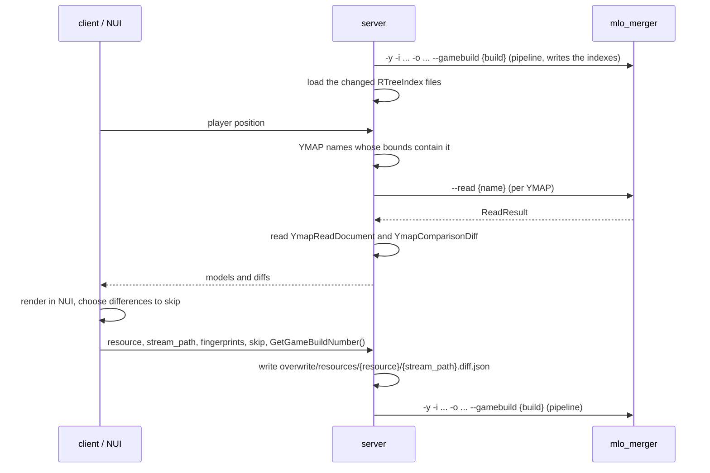

# Using MLO Merger From A FiveM Resource

This guide shows how a FiveM resource calls the `mlo_merger` executable to show
nearby YMAP changes in NUI and to write overwrites that leave chosen changes out
of the merge. See the [command reference](reference.md) for every option and
[ARCHITECTURE](ARCHITECTURE.md) for the workflow.

## Types

The JSON files and outputs below have TypeScript types in `asset/gen_mlo_merger.ts`.
It is included in release archives; in a checkout, generate it with `cargo export-types`.

Release archives also contain `release.json`, naming the build they hold:

```json
{
  "name": "mlo_merger",
  "version": "2.0.0",
  "tag": "v2.0.0",
  "commit": "<commit SHA>",
  "repository": "https://github.com/nnnnusui/mlo_merger",
  "release_url": "https://github.com/nnnnusui/mlo_merger/releases/tag/v2.0.0",
  "targets": ["aarch64-apple-darwin", "x86_64-pc-windows-msvc", "x86_64-unknown-linux-gnu"]
}
```

`targets` lists the platforms whose executables the archive holds: one in a platform
archive, every one in `mlo_merger-all-<tag>.zip`. `mlo_merger-all-<tag>.zip` also holds the browser build
in `web/`, described under `web` in its `release.json`; see [Browser build](web.md).

| Data | Type |
|---|---|
| Stream-file bounds index | `RTreeIndex`, `RTreeItem`, `RTreeInput` |
| `--read` stdout | `ReadResult`, `ReadFileResult`, `ReadOrigin` |
| `--read` JSON documents | `YmapReadDocument`, `ReadFingerprint`, `Ymap`, `YmapEntity`, `Position`, `Rotation` |
| Source-cache diff documents | `YmapComparisonDiff`, `YmapComparisonFile`, `YmapDiffFields`, `YmapEntityDiff`, `YmapEntityFieldDiff` |
| Changes carried to newer DLC generations | `YmapPropagatedDiff`, `YmapPropagationOrigin` |
| Vanilla YMAP generations | `GenerationIndex`, `GenerationUnit` |
| Overwrite documents | `StreamFileOverwrite`, `OverwriteFingerprint`, `YmapDiffSkip`, `VanillaOverwrite` |
| Overwrite cache | `AddedStreamFiles`, `AddedStreamFile`, `AddedStreamFileSource`, `LeftOutAddition`, `AddedItem`, `OverwriteWarnings`, `SourceUpdate`, `SourceVersion`, `SourceUpdateOutcome` |
| Pipeline stdout | `PipelineReport`, `PipelineChanges`, `StoreChanges`, `OverwriteWarnings`, `IgnoredOverwrite`, `IgnoredOverwriteReason` |
| Merge diagnostics | `DuplicateReport` |

```typescript
import type {
  OverwriteFingerprint, PipelineReport, ReadResult, RTreeIndex, StreamFileOverwrite, Ymap,
  YmapComparisonDiff, YmapDiffSkip, YmapEntity, YmapEntityDiff, YmapReadDocument,
} from "./gen_mlo_merger";
```

The examples below copy it to `shared/gen_mlo_merger.ts`.

## Running The Executable

Start the executable from server-side code with `spawn` (spawnProcess).

- Always pass an operation flag. Without arguments the executable opens the vanilla
  generator GUI; run the pipeline as `mlo_merger --pipeline`.
- Set the working directory to the directory containing `asset/`. Every path
  below, and every command default, is relative to it.
- Paths recorded in the JSON files are relative to the store holding each file (see
  [Recorded Paths](#recorded-paths)), so they stay valid when `asset/` moves. Command results
  on stdout name files as the command was given them.
- stdout carries only the command's result; `--read` and the pipeline each print one
  line of JSON.
- stderr carries progress logs and errors. The same log is written to
  `asset/log/mlo_merger_{timestamp}.log`, which is only created when the run logs
  something.
- A failed command exits with code `1`; its last stderr line is the error.
- Commands never prompt. Pipeline commands also accept `-y`.

```typescript
// server/merger.ts
import { spawn } from "child_process";

const MERGER = "C:/tools/mlo_merger/mlo_merger.exe";
export const MERGER_CWD = "C:/tools/mlo_merger"; // contains asset/

export interface MergerOutput {
  stdout: string;
  stderr: string;
}

export function runMerger(args: string[]): Promise<MergerOutput> {
  return new Promise((resolve, reject) => {
    const child = spawn(MERGER, args, { cwd: MERGER_CWD, windowsHide: true });
    let stdout = "";
    let stderr = "";
    child.stdout.on("data", (chunk: Buffer) => (stdout += chunk));
    child.stderr.on("data", (chunk: Buffer) => (stderr += chunk));
    child.on("error", reject);
    child.on("close", (code) =>
      code === 0 ? resolve({ stdout, stderr }) : reject(new Error(stderr.trim().split("\n").pop()))
    );
  });
}
```

### Game Build

Pass the game build the server's clients run, the value `GetGameBuildNumber()` returns on
a client, as `--gamebuild` to every command that runs the vanilla-cache step: the pipeline,
`--generate-vanilla-cache`, `--generate-source-cache` and `--merge`. The vanilla cache and
merge then use vanilla files as of that build, so they match `sv_enforceGameBuild`. On the
server `GetGameBuildNumber()` returns `0`, so a client has to send the value.

- Omit `--gamebuild` when the value is `0` (unknown); the vanilla cache then uses the
  latest installed stage.
- Pass the same value to every run. A run without it, or with another build, rebuilds the
  vanilla cache for that build.
- A build that is not listed under `[gamebuild]` in `asset/config.toml` uses the closest
  listed build below it and logs a warning; add it there when FiveM supports a new build.

```typescript
// server/merger.ts
/** `--gamebuild` for a client's `GetGameBuildNumber()`; none for 0 (unknown). */
export const gameBuildArgs = (build: number): string[] =>
  build > 0 ? ["--gamebuild", String(build)] : [];
```

Paths below are defaults. If you change them with options such as `--source-cache`,
`--overwrite` or `-o`, change the paths you read accordingly.

## Recorded Paths

Every path recorded in a JSON file is relative to a store, so the files stay valid when
`asset/` is moved or the stores are named by other paths; only their contents decide whether
a stage reuses its output. The one exception is the vanilla cache's path to the vanilla
archive, which is absolute when the two are on different drives.

| Path relative to | Recorded for |
|---|---|
| The source cache (`asset/source-cache`) | Source files moved into the cache: `resources/{resource}/{stream path}` |
| The source root (`asset/source`) | Resources (their IDs), source files left in them, and each source's original path |
| The vanilla cache (`asset/vanilla-cache`) | The vanilla archive the cache was built from (`vanilla_dir` in its `cache_info.json`, absolute only when the two share no root) |
| The vanilla archive (`asset/vanilla`) | Latest vanilla files and vanilla versions read by `--read`: `{version}/{ymap,ybn}/{file name}`; and `hash_names.json` |
| The merge output (`asset/merged`) | Merged files: `{ymap,ybn}/{file name}` |

A bounds index's `path` and a merge input's `path` name the file relative to its own store:
a latest vanilla file relative to the vanilla archive, a source file moved into the cache
relative to the source cache, otherwise relative to the source root. `originalPath` and a merge input's `original_path` are always relative to the
source root.

## Commands And Files

| Step | Arguments | Result | Files to read afterwards |
|---|---|---|---|
| Index file bounds | none; written by vanilla-cache, source-cache and merge runs | | `asset/{vanilla-cache,source-cache,merged}/stream_file_rtree.json` (`RTreeIndex`) |
| Convert YMAPs to JSON | `--read FILE` | `ReadResult` | each `files[].output` (`YmapReadDocument`) |
| Inspect differences | none; written by source-cache generation | | `asset/source-cache/diff/{resource}/{stream_path}.diff.json` (`YmapComparisonDiff`) |
| Inspect changes carried to newer DLC generations | none; written by source-cache generation | | `asset/source-cache/propagated/{resource}/{file_name}.diff.json` (`YmapPropagatedDiff`); each carried item's `reason` names the item it came from |
| Inspect vanilla version differences | none; vanilla-cache generation would write them, but it is currently disabled | | `asset/vanilla-cache/ymap_versions.json` (`VanillaYmapVersionIndex`), then `asset/vanilla-cache/diff/{version}/ymap/{name}.diff.json` (`VanillaYmapDiff`) for each version after a YMAP's first |
| Apply overwrites | `--pipeline`, or `--merge` then `--deploy` | `PipelineReport` (pipeline only) | `asset/merged/duplicates.json` (`DuplicateReport`) |
| Check overwrites | `--generate-overwrite-cache`; also run by `--merge` and `--pipeline` | | `asset/overwrite-cache/warnings.json` (`OverwriteWarnings`), `asset/overwrite-cache/added_stream_files.json` (`AddedStreamFiles`) |

### Stream-File Bounds Indexes

Each store keeps the bounds of its stream files in its own `stream_file_rtree.json`, written
when the store is built (by its own command or by the pipeline):

| Index | Files | Listed from | Rebuilt after |
|---|---|---|---|
| `asset/vanilla-cache/stream_file_rtree.json` | latest vanilla files | `asset/vanilla-cache/cache_info.json` | a vanilla-cache update |
| `asset/source-cache/stream_file_rtree.json` | inventoried source stream files, in source or moved into the cache | `asset/source-cache/cache_info.json` | a source-cache update |
| `asset/merged/stream_file_rtree.json` | merged files | `asset/merged/cache_info.json` | a merge that changed output |

Each `RTreeIndex` has `ymap` and `ybn` arrays of `RTreeItem`s with RBush-compatible
`minX`/`minY`/`maxX`/`maxY`, plus `minZ`/`maxZ`, the file `name` and `path`, the `resource`
ID (and `originalPath`, relative to the source root, when moved into the cache) for source
files, and the `version` for
vanilla files. Its `input` records the fingerprint of the metadata it was listed from.

A vanilla item's `version` is the version folder holding the file, the same value `--read`
reports as `origin.Vanilla.version`, so once read its document is
`asset/read-cache/vanilla/{version}/ymap/{name}.json`. `--read` reads vanilla as of the stage
the vanilla cache was built for, so the two agree whichever `--gamebuild` the pipeline ran
with.

An index is rewritten only when that metadata changed, or when the index is missing or of an
earlier layout, so a run that reuses its store also creates the index of an existing store.
An index that changed has a new `timestamp`; reload an index when its file changed. Source
files outside the inventory, such as YMAPs outside `stream/`, are not indexed, and source
changes appear only after the source cache is updated. Files whose bounds cannot be read are
left out with a warning.

Load the result into RBush, or filter it directly, to find the files at a position.

### `--read`

```bash
mlo_merger --read hei_ch1_11.ymap
mlo_merger --read hei_ch1_11.ymap hei_ch1_12.ymap
```

Given only file names, `--read` reads each file from every resource holding it and from
vanilla. The last stdout line is a `ReadResult`:

```json
{"files":[
  {"origin":{"Resource":{"resource":"sample_resource_a","stream_path":"hei_ch1_11.ymap"}},
   "input":"asset/source-cache/resources/sample_resource_a/hei_ch1_11.ymap",
   "output":"asset/read-cache/resources/sample_resource_a/hei_ch1_11.ymap.json","updated":true},
  {"origin":{"Vanilla":{"version":"0012-mpheist","file_name":"hei_ch1_11.ymap"}},
   "input":"asset/vanilla/0012-mpheist/ymap/hei_ch1_11.ymap",
   "output":"asset/read-cache/vanilla/0012-mpheist/ymap/hei_ch1_11.ymap.json","updated":false}
]}
```

- `output` is the `YmapReadDocument` to read; its `model` is the `Ymap`.
- `updated: false` means the existing JSON still describes the file and was not rewritten.
  It is still valid to read.
- For `origin.Resource`, `resource` (the resource directory name) and `stream_path`
  (the path below `stream/`) also key the diff document and the overwrite.
- For `origin.Vanilla`, `version` is the version folder holding the file: the last version,
  up to the stage read, that changed it, not necessarily that stage itself. Its document
  sits under that folder in `asset/read-cache/vanilla`.
- Vanilla is read as of the stage the vanilla cache was built for, the game build the last
  pipeline ran with, so it is the vanilla the merge used; pass `--gamebuild` to read another
  build's.
- If a resource holds several files with that name, the command fails and writes nothing.
  Read them individually with `--resource NAME stream/relative/path.ymap`.
- Several names are read in one run, in the order given. If any name matches no file or is
  ambiguous, the whole command fails and writes nothing, so read names one at a time when
  some may be missing.
- `--read --resource NAME --version SHA256 FILE` reads the earlier version with that SHA-256
  of a resource's file, which the source cache keeps in its history, as
  `origin.History`, to `asset/read-cache/history/{resource}/{stream_path}/{sha256}.ymap.json`.
- `--read --all` reads every YMAP of every resource and of vanilla, for
  tools that want all documents up front.

### How Diff Documents Compose

Every `.diff.json` holds differences from a base, and the merge composes them. Each kind has
its own base:

| Document | Base | Holds |
|---|---|---|
| `asset/source-cache/diff/{resource}/{stream_path}.diff.json` | The resource's baseline YMAP: the vanilla YMAP of that name, an empty YMAP, or the base source's YMAP | `diffs`, the resource's differences |
| `asset/overwrite/resources/{resource}/{stream_path}.diff.json` | The source-cache diff document at the same path | `skip`, the differences of that document to cancel |
| `asset/overwrite/vanilla/{version}/ymap/{file_name}.diff.json` | The latest vanilla YMAP, `{version}/ymap/{file_name}` in the vanilla archive | `diffs`, differences of its own |

- A diff document leads from its `base` file to its `target` file. Array differences name
  base items by `base_index`, so the diffs of several resources from one base combine
  without their indices conflicting, and name where the target file has an item by
  `target_index`, which picks out one item of one diff.
- A resource overwrite is a diff of a diff. It sits at the same relative path as the diff
  document it applies to, is tied to that document's files by its `target` and `base`
  fingerprints, and its `skip` cancels any of the document's differences, from whole
  fields and array items down to single changes within an item; `ignore` cancels the file
  whole. It adds no differences of its own.
- The merge applies to each base YMAP every resource's diff, with that resource's
  overwrite applied, in merge order, then the vanilla overwrite as the last source. Where
  sources change the same item, the merge policy decides (see
  [Combining Sources](reference.md#combining-sources)); an overwrite does not override it.

### Diff Documents

Source-cache generation writes one diff document for every source YMAP: against the vanilla
YMAP it replaces, or, for a YMAP the resource adds, against its baseline (see
[Added Stream Files](reference.md#added-stream-files)):

```text
asset/source-cache/diff/{resource}/{stream_path}.diff.json
```

- `diffs` holds the resource's differences from vanilla. Overwrite `skip` selectors pick
  entries from it.
- `target` is the source YMAP and `base` its baseline, the YMAP the differences are taken
  from. Copy `target.sha256`/`size` and `base.sha256`/`size` into the overwrite unchanged.
  `target.path` and `base.path` name the files relative to their stores, such as
  `resources/{resource}/{stream_path}` and `{version}/ymap/{file_name}` in the vanilla archive.
  For an added YMAP,
  `base.path` is empty: it is compared with an empty YMAP.
- Array differences are `Added`, `Removed`, `Modified` (and `Replaced` for non-entity arrays).
  `base_index` indexes the baseline (vanilla) model and `target_index` the source model:
  `Removed` and `Replaced` name their item by `base_index`, `Modified` by both, and `Added`
  by `target_index`, with `anchor_base_index`, the baseline item it is placed after (`null`
  when first). Added entities carry their whole entity, including its `guid`.
- Select an addition by its `target_index`, which names exactly one item of the source
  file: `{ "Added": { "target_index": 12 } }`. A GUID, as in
  `{ "Added": { "entity": { "guid": ... } } }`, selects every addition with that GUID, so
  it is not unique when entities share one or have none (`0`).
- An added YMAP's diff lists each of its items as `Added`. When several resources add a
  YMAP of that name, only the merged resources' overwrites apply; the others' are listed
  as `missing_source`.
- YMAPs without a diff document, such as those whose diff could not be taken, cannot be
  overwritten.

### Overwrite Documents

```text
asset/overwrite/resources/{resource}/{stream_path}.diff.json
```

A resource overwrite cancels differences of the diff document at the same path (see
[How Diff Documents Compose](#how-diff-documents-compose)).

```json
{
  "schema_version": 2,
  "target": { "sha256": "<diff document target.sha256>", "size": 5638 },
  "base":   { "sha256": "<diff document base.sha256>",   "size": 5675 },
  "skip": {
    "entities": [
      { "Modified": { "base_index": 0, "changes": { "position": true } } },
      { "Added": { "target_index": 12 } }
    ],
    "box_occluders": [{ "Removed": { "base_index": 0 } }]
  }
}
```

- There is one document per stream file, at the same relative path as its diff document
  (`asset/source-cache/diff/{resource}/{stream_path}.diff.json`, or the overwrite cache's).
  Resource names and stream paths are matched case-insensitively.
- `{ "schema_version": 2, "ignore": true }` leaves the stream file out of the merge whole,
  whatever it holds; it needs no fingerprints. For a YMAP several resources add, the file is
  also left out of the choice of which one wins. It does not keep the file from being
  deployed when nothing merged takes its name.
- In an object, `true` leaves out a field's whole difference; a nested selector leaves out
  only the parts it names.
- In an array, a selector leaves out the entries whose written fields all match. With
  `changes`, only the named changes are left out rather than the whole entry.
- An overwrite whose `target` or `base` no longer matches the current files is not
  applied. The pipeline lists it in `ignored_overwrites` (see
  [Pipeline Output](#pipeline-output)) on every run until it is rewritten from the new diff
  document.

See [docs/sample/overwrite](sample/overwrite/README.md) for complete examples.

### Vanilla Overwrite Documents

```text
asset/overwrite/vanilla/{version}/ymap/{file_name}.diff.json
```

A vanilla overwrite is a diff document of its own against a latest vanilla YMAP, merged
after every resource's (see [How Diff Documents Compose](#how-diff-documents-compose)).
Its path is the file's path in the vanilla archive, `{version}/ymap/{file_name}`, with
`.diff.json` appended: `{version}` is the stage folder holding the latest file, the
`origin.Vanilla.version` `--read` reports for it.

```json
{
  "schema_version": 2,
  "base": { "sha256": "<latest vanilla file sha256>", "size": 5675 },
  "diffs": {
    "entities": [{ "Removed": { "base_index": 3 } }]
  }
}
```

- `diffs` is written in the same shape as a diff document's `diffs`, against the latest vanilla
  model (`--read` returns it with its fingerprint): `base_index` indexes the vanilla model.
  `target_index` names no file here and is left out.
- It is merged as the last source, after every resource's diff with its resource overwrite
  applied. The merge policy still decides: a removal wins, and otherwise a resource's earlier
  change to the same item wins over the overwrite.
- Name, flags, extents, block, the distant LOD light counts and physics dictionary removals
  are left out of every resource's diff but apply from the vanilla overwrite. To keep a
  resource's extents, for example, copy its `streaming_extents_*`/`entities_extents_*`
  differences from the resource's diff document into the vanilla overwrite. The value is
  tied only to the vanilla file, so it is not updated when the resource changes.
- A vanilla YMAP with an overwrite is merged even when no resource replaces it.
- An overwrite whose `{version}` is not the latest file's, as after a game update or with
  another `--gamebuild`, or whose `base` no longer matches the latest vanilla file, is not
  applied and is listed in the pipeline's `ignored_overwrites`. Write it for the new version
  after a vanilla update. Overwrites of several versions of a file can be kept side by side;
  only the latest version's applies.

### Added Stream Files Several Resources Ship

A stream file no vanilla file is named after is compared with an empty file of its format, so
its source-cache diff document lists everything in it as additions. When several resources ship
one, every version is merged (YMAPs only, so far):

- Versions are merged from the resource whose name sorts last (the one loaded last), which
  wins where they conflict. `asset/overwrite-cache/added_stream_files.json`
  (`AddedStreamFiles`) lists each added file's `sources` in that order and every resource
  shipping it (`shipped_by`).
- An addition an earlier version makes already is left out; for a YMAP:

  | Item | Left out when an earlier version adds |
  |---|---|
  | Entity | An entity with the same GUID, even with other values; or one of the same type, archetype and LOD level at the same position, within the `ymap` [matching tolerance](reference.md#matching-configuration), whatever its rotation, scale and GUID. Children pointing at it, in its YMAP or another, point at the kept one. One with a GUID is kept when the earlier entity has none, which children could not point at |
  | Box occluder, occlude model, grass batch, time-cycle modifier, car generator | An equal item, within the [matching tolerances](reference.md#matching-configuration) |
  | Physics dictionary, prop instance name | The same name (as for every merge) |
  | LOD light, distant LOD light | Never: they pair by index across the two YMAPs of a LOD light pair |

- The extents cover every version's. Name, flags and block come from the first version.
- Leave out what remains doubled with a resource overwrite written from that resource's
  source-cache diff document, as for any source, or leave a version out with `ignore`.
- `added_stream_files.json` lists each addition left out in the file's `left_out`. It names the stream file
  and the item, by its array (as diff documents name it) and its index in that file, with the
  item of an earlier version kept in its place:

  ```json
  "left_out": [
    {
      "resource": "smpl_custom_props", "stream_path": "smpl_custom_01.ymap",
      "field": "entities", "index": 1,
      "kept": {
        "resource": "smpl_custom_props_v2", "stream_path": "smpl_custom_01.ymap",
        "field": "entities", "index": 2
      }
    }
  ]
  ```

  It is taken from the source-cache diff documents with the resource overwrites applied, as
  the merge thins them, so an overwrite leaving out the kept item brings the other back.

### Applying Overwrites

```bash
mlo_merger --pipeline -y -i <resources directory> -o <deployed resource> --gamebuild <GetGameBuildNumber()>
```

The pipeline updates the source cache, merges and deploys only what changed. Overwrites are
part of merge freshness, so `-f` is not needed. Use `--merge` alone to update only
`asset/merged`. Overwrites that are not applied are listed in the pipeline's
`ignored_overwrites` and in `asset/overwrite-cache/warnings.json` (see
[Overwrite Warnings](#overwrite-warnings)); both commands also log each one on stderr as a
warning starting with `Overwrite of`.

#### When Source Or Vanilla Files Change

An overwrite is written against the files its fingerprints name. When the game build moves
the latest vanilla file, or a resource is updated and its overwrite cannot be followed (see
below), the next run (the pipeline updates the source cache first) merges the file again
without the overwrite: the overwrite is left out whole, not partially applied, and the
overwrite document is not changed. The merge does not fail.

When only the resource's file changed, the source cache keeps the version the overwrite was
written against (`asset/source-cache/history/{resource}/{stream_path}/{sha256}.*`), and
building the overwrite cache compares that version's diff document with the current one:

- Selectors naming a `target_index` are first pointed at the same item of the current
  version: the modification of the same vanilla item, or the addition equal to the earlier
  one, else of the entity with the same non-zero GUID, else of the one with the same type,
  archetype and LOD level at the same position (within the `ymap` matching tolerance). A
  selector with no single such item is kept as it is.
- If every difference the overwrite left out is still left out by the same selector, or the
  resource no longer makes it, and the selectors leave out nothing new, the overwrite is
  **rewritten in `asset/overwrite`** against the current version, without the selectors that
  match nothing any more, and applies again.
- Otherwise, as when an added entity with the same GUID or placed alike, or the change to
  the same vanilla item, differs, it is left as it is and listed in `ignored_overwrites`, to be written again.
- Either way `asset/overwrite-cache/source_updates/{resource}/{stream_path}/{sha256}.json`
  (`SourceUpdate`), named after the version it was written against, records it: the
  overwrite as it was (`overwrite`), the differences it left out of that version's diff
  (`reverted`, a diff document's `diffs`), both versions' files relative to the source cache
  (`before`, `after`), the `outcome` (`rewritten` or `manual`), the `reasons` for `manual`,
  and the `rewritten` overwrite. These records are kept; read them to review what was done.
- To see the reverted items in place, read the earlier version with
  `--read --resource {resource} --version {sha256} {stream_path}` (see [`--read`](#--read)).
- A vanilla update is not followed yet.

- A merge that reuses its previous output still checks every overwrite, so
  `ignored_overwrites` lists an outdated overwrite on every run, not only on the run where the
  files changed.
- Write a new overwrite from the current diff document (or, for a vanilla overwrite, the
  current `--read` fingerprint), or remove the entry, to clear it.
- Selectors of an applied overwrite that match no difference are only logged on stderr as
  `Overwrite of ... skips ..., which is not among the differences`; the rest of that
  overwrite still applies.

### Overwrite Warnings

`--generate-overwrite-cache` (and so `--merge` and `--pipeline`) writes
`asset/overwrite-cache/warnings.json` (`OverwriteWarnings`): the overwrites that no longer
match the current source and vanilla caches. It is rewritten
whenever the caches or the overwrites change, the merge logs every entry on stderr on each
run, and the pipeline prints the same lists (see [Pipeline Output](#pipeline-output)).

```json
{
  "ignored_overwrites": [
    { "resource": "resource_a", "file": "hei_ch1_11.ymap", "reason": "source_changed" },
    { "file": "hei_ch1_12.ymap", "reason": "vanilla_changed" }
  ]
}
```

| List | Entry | Clear it by |
|---|---|---|
| `ignored_overwrites` | An overwrite not applied after a source or vanilla update; see [the reasons](#pipeline-output) | Rewriting the overwrite from the current diff document, or removing it |

### Pipeline Output

The pipeline prints one line of `PipelineReport`: the files its cached stages added, modified
or removed (`PipelineChanges`), and the [overwrite warnings](#overwrite-warnings):

```json
{
  "vanilla_cache": { "added": [], "modified": [], "removed": [] },
  "source_cache": {
    "added": [],
    "modified": ["asset/source-cache/resources/sample_resource_a/hei_ch1_11.ymap"],
    "removed": []
  },
  "merged": { "added": [], "modified": ["asset/merged/ymap/hei_ch1_11.ymap"], "removed": [] },
  "ignored_overwrites": [
    { "resource": "sample_resource_a", "file": "hei_ch1_11.ymap", "reason": "source_changed" },
    { "file": "hei_ch1_12.ymap", "reason": "vanilla_changed" }
  ]
}
```

- Each path is placed below the directory the pipeline used for that store (`--vanilla-cache`,
  `--source-cache`, `--merged`), so with the defaults it is relative to the working directory.
- `vanilla_cache` lists the latest vanilla YMAP/YBN files, placed below the vanilla archive
  (`--vanilla`) since the vanilla cache names them there; a file a newer stage replaces is
  listed as removed and the newer stage's file as added. `source_cache` lists the stream files
  moved into the cache, and `merged` the merged stream files.
  Metadata, indexes and diff documents are not listed.
- Only content changes count: a forced rebuild that writes the same bytes lists nothing, and a
  run that changes nothing prints empty lists.
- `ignored_overwrites` is the current state, not a change, as `warnings.json` records it.
- `ignored_overwrites` lists every overwrite that does
  not apply to the current files, on every run. An entry with `resource` is the resource
  overwrite `resources/{resource}/{file}.diff.json`; one without is the vanilla overwrite
  `vanilla/{file}.diff.json`, `file` being its path in the vanilla archive such as
  `0000-base/ymap/{file_name}`. Both names are lowercase; documents are matched
  case-insensitively. `reason` is one of:

  | `reason` | Meaning |
  |---|---|
  | `unsupported_format` | `file` is of a format overwrites do not support yet (only YMAPs are supported) |
  | `source_changed` | The source stream file differs from `target` |
  | `vanilla_changed` | The latest vanilla file differs from `base` (the source, if any, is unchanged), or a vanilla overwrite names another version of the file than the latest |
  | `missing_source` | The resource merges no stream file at `file`, for example after it was removed or excluded |
  | `missing_vanilla` | No latest vanilla file has the file name of `file` |
- Deployment is not included; its counts are logged on stderr.

## Example: From Player Position To Overwrite

This example finds the YMAPs around the player, converts them to JSON, renders their
differences in NUI, and writes the differences the user rejects as an overwrite.



### Shared Message Types

```typescript
// shared/types.ts
import type { OverwriteFingerprint, Ymap, YmapComparisonDiff, YmapDiffSkip } from "./gen_mlo_merger";

/** One source YMAP sent to NUI. */
export interface InspectedFile {
  name: string;
  resource: string;
  streamPath: string;
  /** The source model; `target_index` points into its arrays. */
  model: Ymap;
  /** The latest vanilla model; `base_index` points into its arrays. */
  vanilla: Ymap | null;
  diff: YmapComparisonDiff | null;
}

/** Differences of one source YMAP to leave out of the merge. */
export interface SkipRequest {
  resource: string;
  streamPath: string;
  target: OverwriteFingerprint;
  base: OverwriteFingerprint;
  skip: YmapDiffSkip;
}
```

### 1. Client: Send The Position

```typescript
// client/main.ts
import type { InspectedFile, SkipRequest } from "../shared/types";

RegisterCommand("mloinspect", () => {
  const [x, y, z] = GetEntityCoords(PlayerPedId(), false);
  emitNet("mlo:inspect", x, y, z);
}, false);

onNet("mlo:files", (files: InspectedFile[]) => {
  SetNuiFocus(true, true);
  SendNUIMessage({ type: "files", files });
});

RegisterNuiCallbackType("skip");
on("__cfx_nui:skip", (request: SkipRequest, cb: (result: unknown) => void) => {
  emitNet("mlo:skip", request, GetGameBuildNumber());
  cb({});
});
```

### 2. Server: Find And Convert The YMAPs

```typescript
// server/inspect.ts
import { existsSync, readFileSync, statSync } from "fs";
import { join, resolve } from "path";
import type { ReadResult, RTreeIndex, Ymap, YmapComparisonDiff, YmapReadDocument } from "../shared/gen_mlo_merger";
import type { InspectedFile } from "../shared/types";
import { MERGER_CWD, runMerger } from "./merger";

const readJson = <T>(path: string): T => JSON.parse(readFileSync(resolve(MERGER_CWD, path), "utf8"));

const stores = { merged: "asset/merged", source: "asset/source-cache", vanilla: "asset/vanilla-cache" };
type Store = keyof typeof stores;
const indexes: Partial<Record<Store, { modified: number; index: RTreeIndex }>> = {};

/** Reloads the bounds indexes that changed; call after each pipeline run. */
export function refreshIndex(): void {
  for (const store of Object.keys(stores) as Store[]) {
    const path = resolve(MERGER_CWD, stores[store], "stream_file_rtree.json");
    if (!existsSync(path)) continue;
    const modified = statSync(path).mtimeMs;
    if (indexes[store]?.modified !== modified) {
      indexes[store] = { modified, index: JSON.parse(readFileSync(path, "utf8")) };
    }
  }
}

/** Names of YMAPs whose bounds contain the position. Use RBush for large indexes. */
function ymapsAt(x: number, y: number, z: number): string[] {
  const items = Object.values(indexes).flatMap((loaded) => loaded.index.ymap);
  const hits = items.filter((item) =>
    item.minX <= x && x <= item.maxX && item.minY <= y && y <= item.maxY && item.minZ <= z && z <= item.maxZ
  );
  return [...new Set(hits.map((item) => item.name))];
}

async function inspect(x: number, y: number, z: number): Promise<InspectedFile[]> {
  if (!indexes.vanilla) refreshIndex();
  const files: InspectedFile[] = [];
  for (const name of ymapsAt(x, y, z)) {
    const { stdout } = await runMerger(["--read", name]);
    const result: ReadResult = JSON.parse(stdout.trim().split("\n").pop()!);
    const vanillaFile = result.files.find((file) => "Vanilla" in file.origin);
    const vanilla: Ymap | null = vanillaFile ? readJson<YmapReadDocument>(vanillaFile.output).model : null;
    for (const file of result.files) {
      if (!("Resource" in file.origin)) continue;
      const { resource, stream_path } = file.origin.Resource;
      const diffPath = join("asset/source-cache/diff", resource, `${stream_path}.diff.json`);
      files.push({
        name,
        resource,
        streamPath: stream_path,
        model: readJson<YmapReadDocument>(file.output).model,
        vanilla,
        diff: existsSync(resolve(MERGER_CWD, diffPath)) ? readJson<YmapComparisonDiff>(diffPath) : null,
      });
    }
  }
  return files;
}

onNet("mlo:inspect", async (x: number, y: number, z: number) => {
  const player = source;
  try {
    emitNet("mlo:files", player, await inspect(x, y, z));
  } catch (error) {
    console.error(`mlo_merger failed: ${(error as Error).message}`);
  }
});
```

Models can be large. To send less to NUI, send only the arrays you render, such as `entities`.

### 3. NUI: Render And Choose Differences

```typescript
// nui/main.ts
import type { YmapEntity, YmapEntityDiff, YmapDiffSkip } from "../shared/gen_mlo_merger";
import type { InspectedFile, SkipRequest } from "../shared/types";

/** The entity a difference describes: added, removed from vanilla, or modified in the source. */
function entityOf(file: InspectedFile, change: YmapEntityDiff): YmapEntity | undefined {
  if ("Added" in change) return change.Added.entity;
  if ("Removed" in change) return file.vanilla?.entities[change.Removed.base_index];
  return file.model.entities[change.Modified.target_index];
}

/** A selector leaving out one entity difference as a whole. */
function entitySelector(change: YmapEntityDiff): YmapDiffSkip {
  if ("Added" in change) return { entities: [{ Added: { target_index: change.Added.target_index } }] };
  if ("Removed" in change) return { entities: [{ Removed: { base_index: change.Removed.base_index } }] };
  return { entities: [{ Modified: { base_index: change.Modified.base_index } }] };
}

window.addEventListener("message", ({ data }: MessageEvent<{ type: string; files: InspectedFile[] }>) => {
  if (data.type !== "files") return;
  for (const file of data.files) {
    if (!file.diff) continue; // no diff document: cannot be overwritten
    for (const change of file.diff.diffs.entities ?? []) {
      // Show archetype_name, position and the change; call skip() when the user rejects it.
      renderRow(file, change, entityOf(file, change), () => skip(file, entitySelector(change)));
    }
  }
});

function skip(file: InspectedFile, selector: YmapDiffSkip): void {
  const { target, base } = file.diff!;
  const request: SkipRequest = {
    resource: file.resource,
    streamPath: file.streamPath,
    target: { sha256: target.sha256, size: target.size },
    base: { sha256: base.sha256, size: base.size },
    skip: selector,
  };
  fetch(`https://${GetParentResourceName()}/skip`, { method: "POST", body: JSON.stringify(request) });
}

declare function renderRow(
  file: InspectedFile, change: YmapEntityDiff, entity: YmapEntity | undefined, onSkip: () => void,
): void;
declare function GetParentResourceName(): string;
```

Entity positions (`YmapEntity.position`) can also be marked in game, for example with `DrawMarker`.

### 4. Server: Write The Overwrite And Apply It

```typescript
// server/skip.ts
import { existsSync, mkdirSync, readFileSync, writeFileSync } from "fs";
import { basename, dirname, resolve } from "path";
import type {
  PipelineReport, StoreChanges, StreamFileOverwrite, YmapDiffSkip,
} from "../shared/gen_mlo_merger";
import type { SkipRequest } from "../shared/types";
import { refreshIndex } from "./inspect";
import { gameBuildArgs, MERGER_CWD, runMerger } from "./merger";

const RESOURCES_DIR = "C:/fxserver/resources";
const DEPLOY_DIR = "C:/fxserver/resources/[local]/mlo_merged";

onNet("mlo:skip", async (request: SkipRequest, gameBuild: number) => {
  const path = resolve(
    MERGER_CWD, "asset/overwrite/resources", request.resource, `${request.streamPath}.diff.json`,
  );
  const current: StreamFileOverwrite | undefined = existsSync(path)
    ? JSON.parse(readFileSync(path, "utf8"))
    : undefined;

  // Keep earlier selectors only while they were written against the same files.
  const sameFiles =
    current?.target?.sha256 === request.target.sha256 && current?.base?.sha256 === request.base.sha256;
  const previous: Exclude<YmapDiffSkip, true> =
    sameFiles && current?.skip && current.skip !== true ? current.skip : {};
  const entities = [
    ...(previous.entities === true ? [] : previous.entities ?? []),
    ...(request.skip !== true && request.skip.entities !== true ? request.skip.entities ?? [] : []),
  ];
  const overwrite: StreamFileOverwrite = {
    schema_version: 2,
    target: request.target,
    base: request.base,
    skip: { ...previous, entities },
  };

  mkdirSync(dirname(path), { recursive: true });
  writeFileSync(path, JSON.stringify(overwrite, null, 2));

  const { stdout } = await runMerger([
    "--pipeline", "-y", "-i", RESOURCES_DIR, "-o", DEPLOY_DIR, ...gameBuildArgs(gameBuild),
  ]);
  const report: PipelineReport = JSON.parse(stdout);
  for (const ignored of report.ignored_overwrites) {
    console.warn(`Overwrite not applied (${ignored.reason}): ${ignored.resource ?? "vanilla"} ${ignored.file}`);
  }
  const changed = (store: StoreChanges) =>
    store.added.length + store.modified.length + store.removed.length > 0;
  const stores = [report.vanilla_cache, report.source_cache, report.merged];
  if (!stores.some(changed)) return; // nothing to reload
  await refreshIndex();
  ExecuteCommand("refresh");
  ExecuteCommand(`ensure ${basename(DEPLOY_DIR)}`);
});
```

- Source-cache generation moves vanilla-named YMAPs out of each resource's `stream`
  directory, so running the pipeline changes resources under `RESOURCES_DIR` while the
  server is running.
- Clients may need to reconnect before they load the updated stream files.
