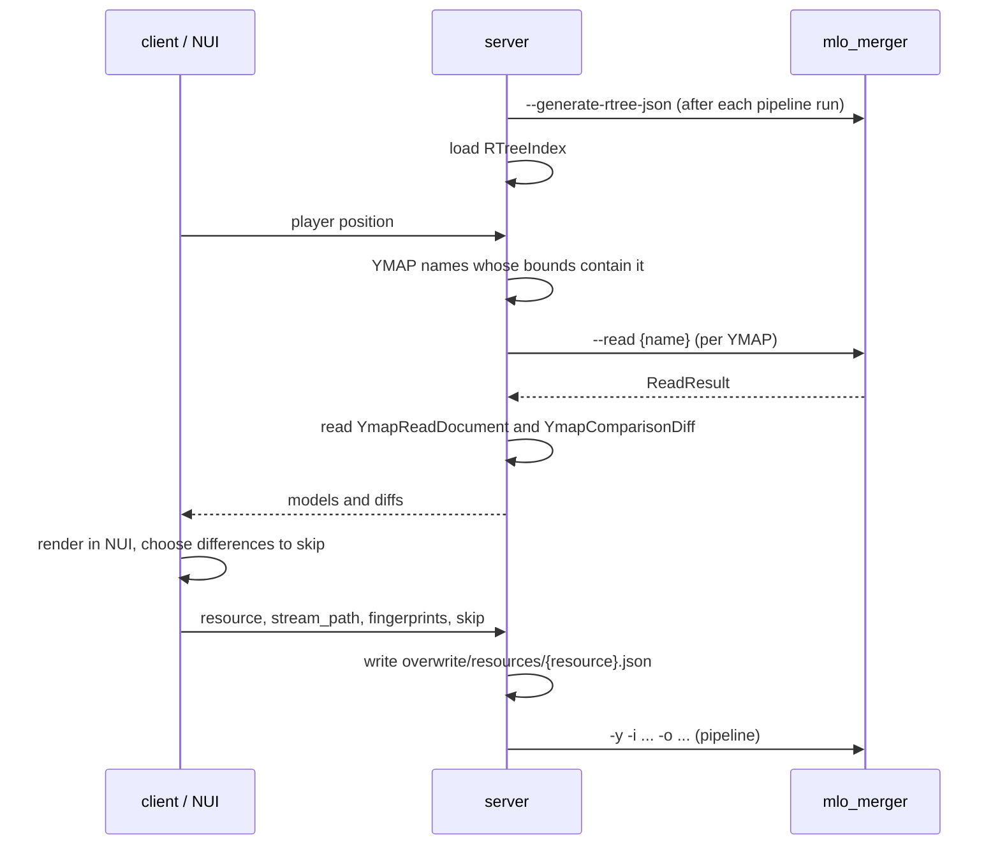

# Using MLO Merger From A FiveM Resource

This guide shows how a FiveM resource calls the `mlo_merger` executable to show
nearby YMAP changes in NUI and to write overwrites that leave chosen changes out
of the merge. See the [Readme](../Readme.md) for every option and
[ARCHITECTURE](ARCHITECTURE.md) for the workflow.

## Types

The JSON files and outputs below have TypeScript types in `asset/gen_mlo_merger.ts`.
It is included in release archives; in a checkout, generate it with `cargo export-types`.

| Data | Type |
|---|---|
| Stream-file bounds index | `RTreeIndex`, `RTreeItem` |
| `--read` stdout | `ReadResult`, `ReadFileResult`, `ReadOrigin` |
| `--read` JSON documents | `YmapReadDocument`, `ReadFingerprint`, `Ymap`, `YmapEntity`, `Position`, `Rotation` |
| Source-cache diff documents | `YmapComparisonDiff`, `YmapComparisonFile`, `YmapDiffFields`, `YmapEntityDiff`, `YmapEntityFieldDiff` |
| Overwrite documents | `ResourceOverwrite`, `StreamFileOverwrite`, `OverwriteFingerprint`, `YmapDiffSkip`, `VanillaOverwrite` |
| Merge diagnostics | `DuplicateReport` |

```typescript
import type {
  OverwriteFingerprint, ReadResult, ResourceOverwrite, RTreeIndex, Ymap,
  YmapComparisonDiff, YmapDiffSkip, YmapEntity, YmapEntityDiff, YmapReadDocument,
} from "./gen_mlo_merger";
```

The examples below copy it to `shared/gen_mlo_merger.ts`.

## Running The Executable

Start the executable from server-side code with `spawn` (spawnProcess).

- Set the working directory to the directory containing `asset/`. Every path
  below, and every command default, is relative to it.
- stdout carries only the command's result; `--read` prints one line of JSON.
- stderr carries progress logs and errors. The same log is written to
  `asset/log/mlo_merger_{timestamp}.log`.
- A failed command exits with code `1`; its last stderr line is the error.
- Commands never prompt. Pipeline commands also accept `-y`.

```typescript
// server/merger.ts
import { spawn } from "child_process";

const MERGER = "C:/tools/mlo_merger/mlo_merger.exe";
export const MERGER_CWD = "C:/tools/mlo_merger"; // contains asset/

export interface MergerOutput {
  stdout: string;
  stderr: string;
}

export function runMerger(args: string[]): Promise<MergerOutput> {
  return new Promise((resolve, reject) => {
    const child = spawn(MERGER, args, { cwd: MERGER_CWD, windowsHide: true });
    let stdout = "";
    let stderr = "";
    child.stdout.on("data", (chunk: Buffer) => (stdout += chunk));
    child.stderr.on("data", (chunk: Buffer) => (stderr += chunk));
    child.on("error", reject);
    child.on("close", (code) =>
      code === 0 ? resolve({ stdout, stderr }) : reject(new Error(stderr.trim().split("\n").pop()))
    );
  });
}
```

Paths below are defaults. If you change them with options such as `--source-cache`,
`--overwrite` or `-o`, change the paths you read accordingly.

## Commands And Files

| Step | Arguments | Result | Files to read afterwards |
|---|---|---|---|
| Index file bounds | `--generate-rtree-json` | log lines only | `asset/read-cache/stream_file_rtree-ymap.json` (`RTreeIndex`) |
| Convert YMAPs to JSON | `--read FILE` | `ReadResult` | each `files[].output` (`YmapReadDocument`) |
| Inspect differences | none; written by source-cache generation | | `asset/source-cache/diff/{resource}/{stream_path}.diff.json` (`YmapComparisonDiff`) |
| Apply overwrites | no operation flag (pipeline), or `--merge` then `--deploy` | log lines only | `asset/merged/duplicates.json` (`DuplicateReport`) |

### `--generate-rtree-json`

Writes the bounds of every merged, source and vanilla YMAP to
`asset/read-cache/stream_file_rtree-ymap.json` (and YBNs to `stream_file_rtree-ybn.json`).
Each `RTreeItem` has RBush-compatible `minX`/`minY`/`maxX`/`maxY`, plus `minZ`/`maxZ`,
the file `name`, and the `resource` ID for source files.

Indexing reads every stream file. Run it after the pipeline has run, not once per query.
Load the result into RBush, or filter it directly, to find the files at a position.

### `--read`

```bash
mlo_merger --read hei_ch1_11.ymap
mlo_merger --read hei_ch1_11.ymap hei_ch1_12.ymap
```

Given only file names, `--read` reads each file from every resource holding it and from the
latest vanilla version. The last stdout line is a `ReadResult`:

```json
{"files":[
  {"origin":{"Resource":{"resource":"sample_resource_a","stream_path":"hei_ch1_11.ymap"}},
   "input":"asset/source-cache/resources/sample_resource_a/hei_ch1_11.ymap",
   "output":"asset/read-cache/resources/sample_resource_a/hei_ch1_11.ymap.json","updated":true},
  {"origin":{"Vanilla":{"version":"0099-mpsum2","file_name":"hei_ch1_11.ymap"}},
   "input":"asset/vanilla/...",
   "output":"asset/read-cache/vanilla/0099-mpsum2/ymap/hei_ch1_11.ymap.json","updated":false}
]}
```

- `output` is the `YmapReadDocument` to read; its `model` is the `Ymap`.
- `updated: false` means the existing JSON still describes the file and was not rewritten.
  It is still valid to read.
- For `origin.Resource`, `resource` (the resource directory name) and `stream_path`
  (the path below `stream/`) also key the diff document and the overwrite.
- If a resource holds several files with that name, the command fails and writes nothing.
  Read them individually with `--resource NAME stream/relative/path.ymap`.
- Several names are read in one run, in the order given. If any name matches no file or is
  ambiguous, the whole command fails and writes nothing, so read names one at a time when
  some may be missing.

### Diff Documents

Source-cache generation writes one diff document for every source YMAP that replaces a
vanilla YMAP:

```text
asset/source-cache/diff/{resource}/{stream_path}.diff.json
```

- `diffs` holds the resource's differences from vanilla. Overwrite `skip` selectors pick
  entries from it.
- Copy `source.sha256`/`size` and `vanilla.sha256`/`size` into the overwrite unchanged.
- Array differences are `Added`, `Removed`, `Modified` (and `Replaced` for non-entity arrays).
  `Removed.index` and `Modified.before_index` index the vanilla model, and
  `Modified.after_index` indexes the source model. Entity differences (`YmapEntityDiff`)
  also carry the `guid`.
- YMAPs without a diff document, such as custom YMAPs that replace no vanilla file, cannot
  be overwritten.

### Overwrite Documents

```text
asset/overwrite/resources/{resource}.json
```

```json
{
  "schema_version": 1,
  "files": {
    "hei_ch1_11.ymap": {
      "source":  { "sha256": "<diff document source.sha256>",  "size": 5648 },
      "vanilla": { "sha256": "<diff document vanilla.sha256>", "size": 5675 },
      "skip": {
        "entities": [
          { "Modified": { "guid": 3592082822, "changes": { "position": true } } },
          { "Added": { "entity": { "guid": 1513947137 } } }
        ],
        "box_occluders": [{ "Removed": { "index": 0 } }]
      }
    }
  }
}
```

- `files` is keyed by `stream_path`. There is one document per resource, so read it and
  replace only the entry you are changing.
- In an object, `true` leaves out a field's whole difference; a nested selector leaves out
  only the parts it names.
- In an array, a selector leaves out the entries whose written fields all match. With
  `changes`, only the named changes are left out rather than the whole entry.
- An overwrite whose `source` or `vanilla` no longer matches the current files is skipped with
  a warning. Rewrite it from the new diff document after a source or vanilla update.

See [docs/sample/overwrite](sample/overwrite/README.md) for complete examples.

### Vanilla Overwrite Documents

```text
asset/overwrite/vanilla/latest/ymap/{file_name}.diff.json
```

```json
{
  "schema_version": 1,
  "vanilla": { "sha256": "<latest vanilla file sha256>", "size": 5675 },
  "diffs": {
    "entities": [{ "Removed": { "index": 3, "guid": 3592082822 } }]
  }
}
```

- `diffs` is written in the same shape as a diff document's `diffs`, against the latest vanilla
  model (`--read` returns it with its fingerprint): `Removed.index` and `Modified.before_index`
  index the vanilla model.
- It is merged as the last source, after every resource's diff with its resource overwrite
  applied. The merge policy still decides: a removal wins, and otherwise a resource's earlier
  change to the same item wins over the overwrite.
- A vanilla YMAP with an overwrite is merged even when no resource replaces it.
- An overwrite whose `vanilla` no longer matches the latest vanilla file is skipped with a
  warning (`Vanilla overwrite of ...`). Rewrite it after a vanilla update.

### Applying Overwrites

```bash
mlo_merger -y -i <resources directory> -o <deployed resource>
```

The pipeline updates the source cache, merges and deploys only what changed. Overwrites are
part of merge freshness, so `-f` is not needed. Use `--merge` alone to update only
`asset/merged`. Overwrites that were not applied are logged on stderr as `Overwrite of ...` or
`Vanilla overwrite of ...`.

## Example: From Player Position To Overwrite

This example finds the YMAPs around the player, converts them to JSON, renders their
differences in NUI, and writes the differences the user rejects as an overwrite.



### Shared Message Types

```typescript
// shared/types.ts
import type { OverwriteFingerprint, Ymap, YmapComparisonDiff, YmapDiffSkip } from "./gen_mlo_merger";

/** One source YMAP sent to NUI. */
export interface InspectedFile {
  name: string;
  resource: string;
  streamPath: string;
  /** The source model; `after_index` points into its arrays. */
  model: Ymap;
  /** The latest vanilla model; `index` and `before_index` point into its arrays. */
  vanilla: Ymap | null;
  diff: YmapComparisonDiff | null;
}

/** Differences of one source YMAP to leave out of the merge. */
export interface SkipRequest {
  resource: string;
  streamPath: string;
  source: OverwriteFingerprint;
  vanilla: OverwriteFingerprint;
  skip: YmapDiffSkip;
}
```

### 1. Client: Send The Position

```typescript
// client/main.ts
import type { InspectedFile, SkipRequest } from "../shared/types";

RegisterCommand("mloinspect", () => {
  const [x, y, z] = GetEntityCoords(PlayerPedId(), false);
  emitNet("mlo:inspect", x, y, z);
}, false);

onNet("mlo:files", (files: InspectedFile[]) => {
  SetNuiFocus(true, true);
  SendNUIMessage({ type: "files", files });
});

RegisterNuiCallbackType("skip");
on("__cfx_nui:skip", (request: SkipRequest, cb: (result: unknown) => void) => {
  emitNet("mlo:skip", request);
  cb({});
});
```

### 2. Server: Find And Convert The YMAPs

```typescript
// server/inspect.ts
import { existsSync, readFileSync } from "fs";
import { join, resolve } from "path";
import type { ReadResult, RTreeIndex, Ymap, YmapComparisonDiff, YmapReadDocument } from "../shared/gen_mlo_merger";
import type { InspectedFile } from "../shared/types";
import { MERGER_CWD, runMerger } from "./merger";

const readJson = <T>(path: string): T => JSON.parse(readFileSync(resolve(MERGER_CWD, path), "utf8"));

let ymapIndex: RTreeIndex | null = null;

/** Rebuilds the bounds index; call after each pipeline run. */
export async function refreshIndex(): Promise<void> {
  await runMerger(["--generate-rtree-json"]);
  ymapIndex = readJson<RTreeIndex>("asset/read-cache/stream_file_rtree-ymap.json");
}

/** Names of YMAPs whose bounds contain the position. Use RBush for large indexes. */
function ymapsAt(x: number, y: number, z: number): string[] {
  const items = [...ymapIndex!.merged, ...ymapIndex!.source, ...ymapIndex!.vanilla];
  const hits = items.filter((item) =>
    item.minX <= x && x <= item.maxX && item.minY <= y && y <= item.maxY && item.minZ <= z && z <= item.maxZ
  );
  return [...new Set(hits.map((item) => item.name))];
}

async function inspect(x: number, y: number, z: number): Promise<InspectedFile[]> {
  if (!ymapIndex) await refreshIndex();
  const files: InspectedFile[] = [];
  for (const name of ymapsAt(x, y, z)) {
    const { stdout } = await runMerger(["--read", name]);
    const result: ReadResult = JSON.parse(stdout.trim().split("\n").pop()!);
    const vanillaFile = result.files.find((file) => "Vanilla" in file.origin);
    const vanilla: Ymap | null = vanillaFile ? readJson<YmapReadDocument>(vanillaFile.output).model : null;
    for (const file of result.files) {
      if (!("Resource" in file.origin)) continue;
      const { resource, stream_path } = file.origin.Resource;
      const diffPath = join("asset/source-cache/diff", resource, `${stream_path}.diff.json`);
      files.push({
        name,
        resource,
        streamPath: stream_path,
        model: readJson<YmapReadDocument>(file.output).model,
        vanilla,
        diff: existsSync(resolve(MERGER_CWD, diffPath)) ? readJson<YmapComparisonDiff>(diffPath) : null,
      });
    }
  }
  return files;
}

onNet("mlo:inspect", async (x: number, y: number, z: number) => {
  const player = source;
  try {
    emitNet("mlo:files", player, await inspect(x, y, z));
  } catch (error) {
    console.error(`mlo_merger failed: ${(error as Error).message}`);
  }
});
```

Models can be large. To send less to NUI, send only the arrays you render, such as `entities`.

### 3. NUI: Render And Choose Differences

```typescript
// nui/main.ts
import type { YmapEntity, YmapEntityDiff, YmapDiffSkip } from "../shared/gen_mlo_merger";
import type { InspectedFile, SkipRequest } from "../shared/types";

/** The entity a difference describes: added, removed from vanilla, or modified in the source. */
function entityOf(file: InspectedFile, change: YmapEntityDiff): YmapEntity | undefined {
  if ("Added" in change) return change.Added.entity;
  if ("Removed" in change) return file.vanilla?.entities[change.Removed.index];
  return file.model.entities[change.Modified.after_index];
}

/** A selector leaving out one entity difference as a whole. */
function entitySelector(change: YmapEntityDiff): YmapDiffSkip {
  if ("Added" in change) return { entities: [{ Added: { entity: { guid: change.Added.entity.guid } } }] };
  if ("Removed" in change) return { entities: [{ Removed: { guid: change.Removed.guid } }] };
  return { entities: [{ Modified: { guid: change.Modified.guid } }] };
}

window.addEventListener("message", ({ data }: MessageEvent<{ type: string; files: InspectedFile[] }>) => {
  if (data.type !== "files") return;
  for (const file of data.files) {
    if (!file.diff) continue; // no diff document: cannot be overwritten
    for (const change of file.diff.diffs.entities ?? []) {
      // Show archetype_name, position and the change; call skip() when the user rejects it.
      renderRow(file, change, entityOf(file, change), () => skip(file, entitySelector(change)));
    }
  }
});

function skip(file: InspectedFile, selector: YmapDiffSkip): void {
  const { sha256, size } = file.diff!.source;
  const request: SkipRequest = {
    resource: file.resource,
    streamPath: file.streamPath,
    source: { sha256, size },
    vanilla: { sha256: file.diff!.vanilla.sha256, size: file.diff!.vanilla.size },
    skip: selector,
  };
  fetch(`https://${GetParentResourceName()}/skip`, { method: "POST", body: JSON.stringify(request) });
}

declare function renderRow(
  file: InspectedFile, change: YmapEntityDiff, entity: YmapEntity | undefined, onSkip: () => void,
): void;
declare function GetParentResourceName(): string;
```

Entity positions (`YmapEntity.position`) can also be marked in game, for example with `DrawMarker`.

### 4. Server: Write The Overwrite And Apply It

```typescript
// server/skip.ts
import { existsSync, mkdirSync, readFileSync, writeFileSync } from "fs";
import { basename, dirname, resolve } from "path";
import type { ResourceOverwrite, StreamFileOverwrite, YmapDiffSkip } from "../shared/gen_mlo_merger";
import type { SkipRequest } from "../shared/types";
import { refreshIndex } from "./inspect";
import { MERGER_CWD, runMerger } from "./merger";

const RESOURCES_DIR = "C:/fxserver/resources";
const DEPLOY_DIR = "C:/fxserver/resources/[local]/mlo_merged";

onNet("mlo:skip", async (request: SkipRequest) => {
  const path = resolve(MERGER_CWD, "asset/overwrite/resources", `${request.resource}.json`);
  const overwrite: ResourceOverwrite = existsSync(path)
    ? JSON.parse(readFileSync(path, "utf8"))
    : { schema_version: 1, files: {} };

  // Keep earlier selectors only while they were written against the same files.
  const current: StreamFileOverwrite | undefined = overwrite.files[request.streamPath];
  const sameFiles =
    current?.source.sha256 === request.source.sha256 && current?.vanilla.sha256 === request.vanilla.sha256;
  const previous: Exclude<YmapDiffSkip, true> = sameFiles && current.skip !== true ? current.skip : {};
  const entities = [
    ...(previous.entities === true ? [] : previous.entities ?? []),
    ...(request.skip !== true && request.skip.entities !== true ? request.skip.entities ?? [] : []),
  ];
  overwrite.files[request.streamPath] = {
    source: request.source,
    vanilla: request.vanilla,
    skip: { ...previous, entities },
  };

  mkdirSync(dirname(path), { recursive: true });
  writeFileSync(path, JSON.stringify(overwrite, null, 2));

  const { stderr } = await runMerger(["-y", "-i", RESOURCES_DIR, "-o", DEPLOY_DIR]);
  for (const line of stderr.split("\n")) {
    if (line.includes("Overwrite of")) console.warn(line); // not applied
  }
  await refreshIndex();
  ExecuteCommand("refresh");
  ExecuteCommand(`ensure ${basename(DEPLOY_DIR)}`);
});
```

- Source-cache generation moves vanilla-named YMAPs out of each resource's `stream`
  directory, so running the pipeline changes resources under `RESOURCES_DIR` while the
  server is running.
- Clients may need to reconnect before they load the updated stream files.
